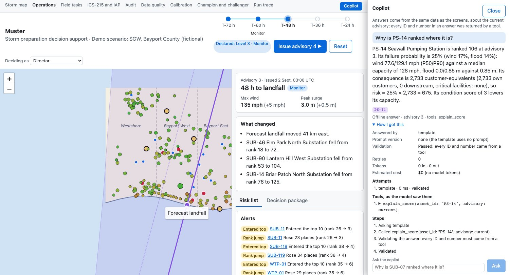
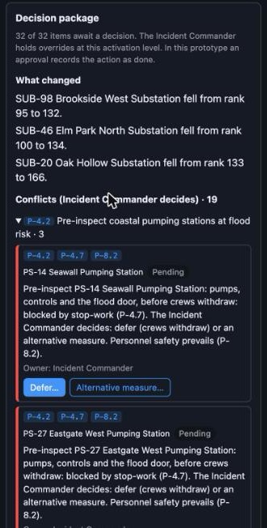

# SGW Storm Preparation Prototype

> **Fictional prototype.** Take-home challenge for the role of AI Solution Engineer (Zug). Not an official AECOM document. SGW (Southeastern Grid & Water), Bayport County, every asset, facility and threshold are invented, and the storm is unnamed (its parameters are modelled on a real past landfall); all data is synthetic. Not for real operations.

A local web app for the Emergency Operations Center (EOC) of a fictional utility, 72 hours before a hurricane lands. Five forecast advisories are replayed one at a time. For each one the app:

1. computes hazard exposure (wind, storm surge, flood depth) for about 200 assets from a 50-member forecast ensemble, and a transparent risk score per asset;
2. evaluates the utility's hurricane playbook with a deterministic rule engine: which actions are required, which are not done (gaps), and where stop-work collides with field work (conflicts);
3. assembles a **decision package**: what changed, the gaps with proposed actions, the conflicts for the Incident Commander, and a draft situation report written by Claude (or a template, offline) with checked citations;
4. waits for people: each item is approved or overridden by role, conflicts are decided only by the Incident Commander, and every step lands in an audit trail.

**Scope:** substations, pumping stations and the treatment plant, the single points of failure for critical customers; distribution assets are out of scope (PRD A10) and follow as an outage-forecast module.

**The prototype prepares; it never acts.** No AI output changes operational state: only a person's recorded decision does.



## Run it

Requirements: Python 3.12 with [uv](https://docs.astral.sh/uv/), Node 20.19+ or 22.12+ (Vite 8) with [pnpm](https://pnpm.io/).

```bash
make install     # backend and frontend dependencies, from the lockfiles
make dev         # backend on http://localhost:8000, frontend on http://localhost:5173
```

Open http://localhost:5173. `make dev` runs offline with the template provider unless `backend/.env` says otherwise.

**With Claude** (the live draft and copilot): copy `backend/.env.example` to `backend/.env` and fill in the key.

```bash
LLM_PROVIDER=anthropic          # or "template" (offline, the default)
LLM_MODEL=claude-sonnet-5-5
ANTHROPIC_API_KEY=...
```

With `LLM_PROVIDER=anthropic` and no key the backend refuses to start and says which variable to set. A failing or ungrounded model answer is never shown: the template takes over and the audit trail says why.

Other commands:

| Command | What it does |
|---|---|
| `make demo-reset` | Back to before advisory 1 (the backend must be running). Restarting the backend also resets. |
| `make data` | Regenerate the synthetic data (seed 42, byte-identical every run) and replay all five advisories to check every demo fact still holds. |
| `make history` | Regenerate the synthetic storm history the challenger trains on (20 fictional storms, seed 42; `make data` runs it too). |
| `make train` | Train the challenger model and compare it with the rule-based champion, by storm and on held-out Storm Delta; writes `docs/eval/challenger_results.json`. |
| `make test` | Every check: ruff, mypy (strict), pytest, oxlint, tsc, vitest (`./scripts/check.sh`). |

The 8-minute demo walkthrough is in [docs/demo_script.md](docs/demo_script.md).

## Using it

- **Issue advisory ▶** in the header replays the next forecast. The timeline shows the five advisories and the activation level (Prepare from T-72 h, Full activation from T-48 h).
- **Map**: assets coloured by failure probability, hospitals, shelters, staging areas, the forecast track, the previous track and the cone. Click an asset to see why it ranks where it does.
- **Risk list**: ranked by risk = failure probability × consequence, with rank changes and alerts.
- **Decision package**: pick your role under *Deciding as*, then approve, override (with a reason) or, as Incident Commander, decide conflicts. Edit and approve the situation report.
- **Copilot**: ask "Why is PS-14 ranked where it is?", "What are the top risks?", "What depends on SUB-07?", "What does P-4.7 say?".
- **Audit** and **Data quality** pages: every step with its actor and versions; every loaded file with its hash and rejected rows.



## Documentation

| Document | Contents |
|---|---|
| [docs/architecture.md](docs/architecture.md) | Components, data flow, and where each part of the plan lives |
| [docs/assumptions_limitations.md](docs/assumptions_limitations.md) | What is simplified, assumed or left out |
| [docs/demo_script.md](docs/demo_script.md) | The scripted demo, with timings |
| [docs/decisions.md](docs/decisions.md) | Every choice the plan left open, with its reason |
| [docs/adr/](docs/adr/) | Architecture decision records |
| [docs/IMPLEMENTATION_PLAN.md](docs/IMPLEMENTATION_PLAN.md), [docs/playbook.md](docs/playbook.md) | The brief: plan and fictional playbook |
| [GLOSSARY.md](GLOSSARY.md) | Domain terms: gap, action, conflict, approval, override, … |
| [CODING_STANDARDS.md](CODING_STANDARDS.md), [AGENTS.md](AGENTS.md) | Rules for code and agents; the definition of done |
