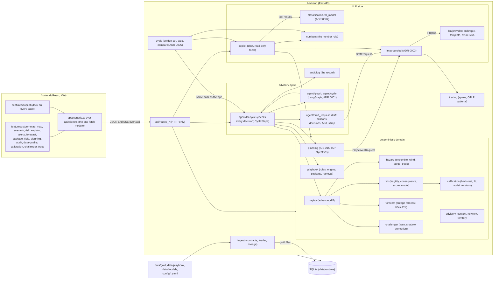
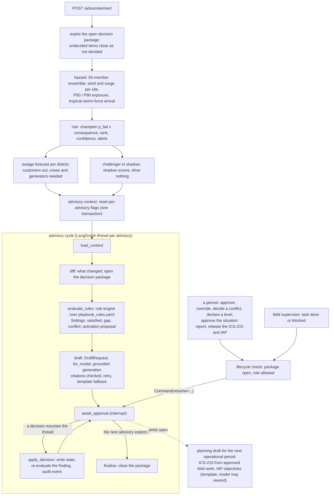

# Architecture

> **Fictional prototype.** Take-home challenge for the role of AI Solution Engineer (Zug). Not an official AECOM document. All names and data are synthetic.

Muster replays five forecast advisories of a fictional hurricane for a utility's EOC. For each advisory, deterministic code computes hazard, risk and an outage forecast, evaluates the playbook and assembles a decision package; a model only writes the draft situation report, answers copilot questions and rewords the IAP objectives, and every answer is validated before anyone sees it. People decide; one step writes what they decided, and the audit log records it. Terms are those of [GLOSSARY.md](../GLOSSARY.md).

## The decisions that shape it

| ADR | Decision |
|---|---|
| [0001](adr/0001-langgraph-for-the-advisory-cycle.md) | LangGraph runs the advisory cycle: the steps, one transaction per step, and the pause for decisions |
| [0002](adr/0002-the-llm-narrates-code-decides.md) | The LLM narrates; code decides rules, scores, planning rows and state |
| [0003](adr/0003-grounded-generation.md) | Grounded generation: one module runs every LLM task as attempt, validate, retry, template fallback |
| [0004](adr/0004-data-classification-before-the-model.md) | Data classification: restricted fields never reach a model |
| [0005](adr/0005-rule-based-evaluation-with-a-gate.md) | Rule-based evaluation with a gate, no LLM judge |
| [0006](adr/0006-champion-and-challenger.md) | Champion and challenger: shadow models and human-approved promotion |
| [0007](adr/0007-human-approval-is-the-only-path-to-state.md) | Human approval and the audit log are the only path to operational state |

Smaller choices, with their reasons, are rows in [decisions.md](decisions.md).

## Modules and seams

Backend packages are under `backend/muster/`, frontend features under `frontend/src/features/`. An arrow means "calls"; the labelled arrows are the seams the tests go through.

The seams:

- **HTTP** (`api/routes_*`): routes parse and serialise only. The frontend reaches them through `api/scenario.ts`, over `api/client.ts`, the one module that calls `fetch`; the copilot's progress is a server-sent event stream (`POST /copilot/chat/stream`).
- **Decision package lifecycle** (`agent/lifecycle.py`): the one answer to "is the package open", the check of every decision (item decisions, declarations, situation report approval, field reports, planning release), and `CycleSteps`, the work behind each graph node. The graph (`agent/graph.py`) keeps only the order and the pause.
- **Playbook** (`playbook/service.py`, `playbook/package.py`): builds the rule inputs, stores findings, re-evaluates one finding, and says what a finding asks for in the package. No other module reads the engine's predicates.
- **Risk model** (`risk/model.py`): the rule-based score and the challenger both implement it; the champion ranks, the challenger scores in shadow.
- **Grounded generation** (`llm/grounded.py`): the only place an LLM task runs; providers are transport (`llm/provider.py`), and a task hands them a `Prompt` and its own validator.
- **Data classification** (`classification.for_model`): applied to a generation request's `shown()` and to every copilot tool result.
- **Audit log** (`audit/log.py`): every system, agent, human and field-supervisor step. **Tracing** (`tracing/`) is observability beside it, never read to decide anything.

## One advisory, end to end

In words, `POST /advisories/next` (`lifecycle.issue_next_advisory`):

1. **Expire** the current advisory's thread: undecided items close as *not decided*, the package closes.
2. **Hazard** (`hazard/`): 50 tracks shifted sideways by N(0, cone radius); per member, a Rankine wind field with inland decay and Gaussian-alongshore surge; per site, P50/P90 wind and flood depth and the median arrival of tropical-storm-force wind.
3. **Risk** (`risk/`, `replay/service.advance`): the champion's failure probability per asset (lognormal fragility curves of the latest approved version, or an approved challenger), one-hop consequence shared among feeders, risk, rank, confidence, stored factors and alerts. A challenger that is not champion scores every asset in shadow.
4. **Outage forecast** (`forecast/`): per district, failures drawn from each member's probabilities and followed through the dependency graph to customers out, crews and generators needed against those available. Context only: never a finding, an ICS-215 row or state.
5. **Advisory cycle** (`agent/graph.py`, one checkpointed LangGraph thread per advisory, [ADR 0001](adr/0001-langgraph-for-the-advisory-cycle.md)): `load_context → diff → evaluate_rules → draft → await_approval ⇄ apply_decision → finalise`.
   - `evaluate_rules` runs the rule engine and turns gaps and conflicts into package items with their proposed actions; the P-2.5 activation proposal is an item too.
   - `draft` builds the draft request (package items, changes, top assets, BM25-retrieved clauses, quoted field notes), filters it, and runs grounded generation; a draft citing anything the request does not show is retried once, then the template writes it. The model call runs outside any database transaction.
   - `await_approval` pauses. Each decision is checked by the lifecycle and resumes the thread; `apply_decision` writes the state, re-evaluates the affected finding and records the audit event in one transaction.
6. **While the package is open**: field supervisors report approved field tasks as done or blocked; the ICS-215 and IAP objectives for the next operational period are drafted and then released by two approvals in order. All through the same check and the same step.

Every node and every generation is a span (`tracing/`); the run trace page shows them per advisory with latency, tokens, estimated cost, retries and fallbacks.

## Beside the advisory cycle

- **Copilot** (`copilot/`, the dock on every page): read-only tools over the same domain functions the screens use, results filtered by `for_model`, answered through grounded generation. An answer may cite only IDs and state only numbers a tool returned in that turn; otherwise the template answers. The dock streams each step and shows "How I got this" (tools, attempts, validation, model, tokens, cost). It declines requests to change anything.
- **Calibration** (`calibration/`, plan M8): back-tests the curves in use on Storm Delta, fits them by MAP with the published curves as the prior, and stores the fit as a proposed model version that a person approves.
- **Champion and challenger** (`challenger/`, [ADR 0006](adr/0006-champion-and-challenger.md)): gradient-boosted trees trained on 20 synthetic storms (`make train`), loaded from `data/models/challenger.pkl` at startup, scored in shadow, proposed only when the promotion rule passes on held-out Storm Delta, promoted only by approval.
- **Storm map and districts** (`territory.py`, `risk/bands.py`, `hazard/track.py`): the default page (`#/`), with the cone, tracks, the four districts, asset risk bands and the outage forecast by district.
- **Data quality** (`ingest/`): every gold file is loaded row by row against its contract; rejected rows and file hashes are shown on the Data quality page.
- **Evaluation** (`evals/`, [ADR 0005](adr/0005-rule-based-evaluation-with-a-gate.md)): the golden set runs through the same lifecycle and copilot; rule checks only, gated in `config/evals.yaml`. `make eval-compare` ranks models by gate, then cost.

## Where the hard rules are enforced

| Rule (CLAUDE.md) | Where |
|---|---|
| The LLM never decides whether a rule is met | `playbook/engine.py` decides; the provider receives a plain-data `DraftRequest` ([ADR 0002](adr/0002-the-llm-narrates-code-decides.md)) |
| The LLM never changes scores or writes state | Providers get no database session; only `CycleSteps.apply` (the `apply_decision` node) writes decided operational state ([ADR 0007](adr/0007-human-approval-is-the-only-path-to-state.md)) |
| Humans approve; the decision log records it | `agent/lifecycle.py` checks, `agent/decisions.py` says who may decide what, `audit/log.py` records; model versions are approved the same way (`calibration/versions.approve`) |
| Template fallback; offline demo | `llm/grounded.py` with `llm/template.py` and `llm/template_chat.py`; `LLM_PROVIDER=template` is the default and the check runs with it |
| Tunable numbers in config | `config/scoring.yaml`, `consequence_weights.yaml`, `models.yaml`, `evals.yaml`, `llm.yaml` |
| No real places | Planar km grid, synthetic coastline; a test rejects real Florida place names (`backend/tests/test_data.py`) |

## Data and storage

- **Gold files** (`data/gold/`), generated by `muster/datagen/generate.py` (`make data`, seed 42) and committed, with JSON Schemas in `contracts/`. Every backend start rebuilds SQLite from them (`data/runtime/`, gitignored). The README's *Sample data* section lists every file.
- **SQLite** via SQLModel (`models.py`): assets, dependencies, facilities, staging areas, districts, advisories, exposure, scores and shadow scores, outage forecasts, alerts, findings, decision packages and items, situation reports, field reports, planning drafts, model versions, operational state, audit events, lineage and trace spans.
- **Checkpoints**: LangGraph's SQLite saver in its own file, cleared by a scenario reset.
- **Committed results** (`docs/eval/`): the evaluation report, the model comparison, the challenger's and the outage forecast's back-tests.

## Tests and CI

`./scripts/check.sh` is the definition of done: ruff, mypy (strict), pytest (in parallel), the evaluation gate with the template provider, oxlint, tsc and vitest. Seams under test: the HTTP API in template mode (including the plan's section 8 scenario), the hazard, risk, forecast and rule-engine functions, grounded generation with fake providers, the data generator and its seed facts, and the frontend's API client and components. No test calls a real model; `make eval-llm` and `make eval-compare` do, by hand.

CI (`.github/workflows/check.yml`) runs the same script on every push and pull request, offline in template mode, on the pinned toolchain, and uploads the eval report and the backend coverage report.
